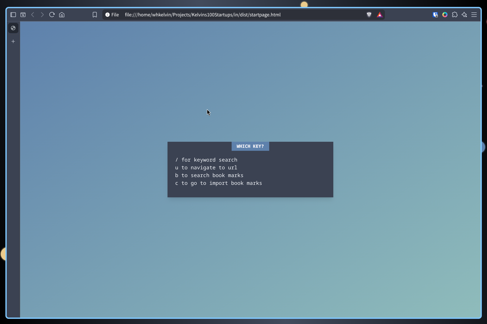

# in

A keyboard-driven browser start page. Set it as your new tab / home page, and you can go to a URL, open a bookmark, or run a keyword search without touching the mouse.



## How it works

Press <kbd>Space</kbd> on the start page. Like the leader key in Vim, it opens a "Which Key?" menu that lists the available actions. Press the key for the action you want:

| Key | Action                                             |
| --- | -------------------------------------------------- |
| `/` | Keyword search (Google)                            |
| `u` | Go to a URL (adds `http://` if you leave it out)   |
| `b` | Search your bookmarks and open one                 |
| `c` | Import bookmarks from a browser-exported HTML file |

Press <kbd>Esc</kbd> to close any dialog.

## Setup

### Prerequisites

- Node.js 18+ and npm

### Install

```bash
git clone <this-repo-url> in
cd in
npm install
```

### Build the start page

The start page is built as a web component (`<home-page>`), bundled into `dist-js/`:

```bash
npm run build:webcomponents
```

This writes `dist-js/components.iife.js` and `dist-js/style.css`. `dist/startpage.html` loads both files, so the page works straight from disk with no server.

### Set it as your start page

Point your browser's home page or new-tab page at the built file:

```
file:///absolute/path/to/in/dist/startpage.html
```

- **Firefox:** Settings → Home → _Homepage and new windows_ → _Custom URLs_, then paste the path above.
- **Chrome/Chromium:** Settings → On startup → _Open a specific page_, then paste the path above. To use it for new tabs as well, you need an extension that sets a custom new-tab URL.

## Customizing

- **Default bookmarks:** edit the `addBookmark(...)` calls in `src/lib/components/HomePage.svelte`, then rebuild.
- **Theme and background:** edit `dist/override.css`. It overrides the color variables and the page background, so you don't need to rebuild.

> Bookmarks you import with `c` are kept in memory only, so they are gone after a page reload. To keep bookmarks, add them as defaults.

## Development

```bash
npm run dev      # SvelteKit dev server
npm run check    # type-check
npm run lint     # prettier + eslint
npm run format   # format with prettier
```
